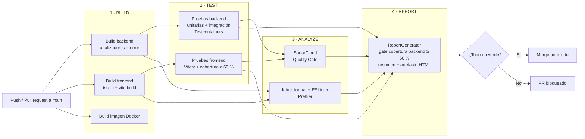

# Manual técnico: pipeline CI/CD y aseguramiento de calidad

## 1. Estructura del repositorio

```
seminario-project/
├── .github/workflows/
│   ├── ci.yml               # Pipeline principal (build → test → analyze → report)
│   └── linea-base.yml       # Medición manual de la línea base (workflow_dispatch)
├── seminario-backend-service/   # API ASP.NET Core 8 (Api, Application, Domain, Infrastructure, Controllers)
├── frontend/                    # SPA React 18 + Vite + TypeScript (integrada con su historial vía git subtree)
├── tests/
│   ├── Seminario.UnitTests/         # xUnit + Moq + EF Core InMemory
│   └── Seminario.IntegrationTests/  # WebApplicationFactory + Testcontainers (SQL Server 2022, MongoDB 7)
├── sql/                         # Scripts SQL de las fases del seminario
├── postman/                     # Colección y environment de Postman
├── docs/                        # SQA Plan, matriz, línea base, reporte de mejora, este manual, evidencias
├── .editorconfig                # Estándar de código C# (aplicado por compilador y dotnet format)
├── coverlet.runsettings         # Formatos y exclusiones de cobertura
└── seminario.sln                # Solución: API + 2 proyectos de prueba
```

## 2. Arquitectura del pipeline



| Job | Etapa | Gate | Falla si… |
|---|---|---|---|
| `1 · Build backend` | build | G1 | Hay un error o **cualquier advertencia** (`TreatWarningsAsErrors` con `ContinuousIntegrationBuild=true`) |
| `1 · Build frontend` | build | G2 | `tsc -b` o `vite build` fallan |
| `1 · Build imagen Docker` | build | G3 | El `Dockerfile` de la API no construye |
| `2 · Pruebas backend` | test | G4 | Falla una prueba unitaria, de integración o de regresión |
| `2 · Pruebas frontend` | test | G5, G7 | Falla una prueba o la cobertura queda por debajo de 60 % (`vitest.config.ts`) |
| `3 · Analisis estatico` | analyze | G8–G10 | `dotnet format --verify-no-changes`, `eslint --max-warnings 0` o `prettier --check` reportan algo |
| `3 · SonarCloud + Quality Gate` | analyze | G11 | El Quality Gate de SonarCloud no pasa (`sonar.qualitygate.wait=true`) |
| `4 · Reporte de calidad` | report | G6 | La cobertura de líneas del backend queda por debajo de 60 %, o falló alguna etapa obligatoria |

## 3. Decisiones técnicas

| Decisión | Alternativas | Motivo |
|---|---|---|
| Testcontainers con SQL Server y MongoDB reales en las pruebas de integración | EF InMemory o SQLite | La lógica crítica vive en SQL Server (SP, triggers, particiones, `rowversion`). Una base en memoria no la ejecuta y daría falsa confianza. |
| Una sola instancia de la API y de los contenedores por ejecución (`ICollectionFixture`) | Un contenedor por clase | Las migraciones y la siembra tardan unos 20 s; compartirlas mantiene la suite de integración por debajo de 1 min. |
| Capturar el código MFA con un `ILoggerProvider` de prueba | Exponer el código o un backdoor de pruebas | No se modifica el comportamiento de producción para facilitar las pruebas. |
| IP por cliente con la cabecera `X-Test-IP` (solo en el host de pruebas) | Desactivar el rate limiting en pruebas | Se prueba el rate limiting real (IT-AUTH-05) sin que interfiera con el resto de casos. |
| `TreatWarningsAsErrors` solo en CI | Siempre | En local se puede compilar con advertencias mientras se trabaja; el pipeline no deja pasar ninguna. |
| SonarScanner for .NET con `scanAll` (un solo proyecto para C# y TS) | Dos proyectos en SonarCloud | Una sola vista y un solo Quality Gate para todo el monorepo. |
| Acciones de GitHub fijadas por SHA y permisos por job | Etiquetas `@v4` y permisos globales | Hallazgos `S7637`/`S8264` de SonarCloud (seguridad de la cadena de suministro). |
| Frontend integrado con `git subtree` | Copiar los archivos | Conserva el historial del frontend (necesario para los casos de regresión). |
| Alcance de cobertura del frontend limitado a API, auth y componentes | Todo `src/` | Las páginas son vistas grandes con poca lógica propia; se documentan como deuda técnica (D3). |

## 4. Ejecutar localmente

### Requisitos

.NET SDK 8, Docker (para las pruebas de integración), Node 20 y pnpm 9.

### Backend

```bash
dotnet restore seminario.sln
dotnet build seminario.sln -c Release -p:ContinuousIntegrationBuild=true   # igual que el pipeline
dotnet test tests/Seminario.UnitTests                                      # rápido, sin Docker
dotnet test tests/Seminario.IntegrationTests                               # requiere Docker
dotnet test seminario.sln --filter Category=Regression                     # solo regresión
dotnet test seminario.sln --settings coverlet.runsettings --collect:"XPlat Code Coverage"
dotnet format seminario.sln --verify-no-changes
```

### Frontend

```bash
cd frontend
pnpm install
pnpm lint --max-warnings 0
pnpm format:check        # pnpm format para corregir
pnpm test:coverage       # reporte en frontend/coverage/index.html
pnpm build
```

## 5. Configuración de SonarCloud

1. Organización `zenvy-crm`, proyecto `zenvy-crm_seminario-project`.
2. *Administration → Analysis Method*: **Automatic Analysis desactivado**. El análisis lo hace el pipeline; si los dos están activos, el scanner falla.
3. Secreto de GitHub `SONAR_TOKEN` (*Settings → Secrets and variables → Actions*).
4. Quality Gate: *Sonar way*, evaluado sobre el código nuevo de cada PR.
5. Exclusiones (definidas en `ci.yml`):
   - **Análisis:** migraciones, `bin/obj`, `frontend/_ds`, `frontend/dist` y `docs`.
   - **Cobertura:** pruebas, páginas, tema, `App.tsx` y tipos del frontend.
   - **Duplicación:** migraciones.

## 6. Protección de la rama `main`

**Aplicada** con el ruleset `enforce_main_security` (*Settings → Rules → Rulesets*), con target *Default branch* y la *bypass list* vacía. Para recrearla desde *Settings → Branches → Add rule* (`main`):

- *Require a pull request before merging*.
- *Require status checks to pass* + *Require branches to be up to date*, con los 8 checks del pipeline.
- *Require conversation resolution*.
- *Do not allow bypassing* (incluye administradores). Sin *force push* ni borrado.

Con el CLI de GitHub y un usuario administrador del repositorio:

```bash
gh api -X PUT repos/zenvy-crm/seminario-project/branches/main/protection --input - <<'JSON'
{
  "required_status_checks": { "strict": true, "contexts": [
    "1 · Build backend", "1 · Build frontend", "1 · Build imagen Docker",
    "2 · Pruebas backend (unitarias + integracion + regresion)",
    "2 · Pruebas frontend (Vitest + Testing Library)",
    "3 · Analisis estatico (formato + ESLint)",
    "3 · SonarCloud + Quality Gate",
    "4 · Reporte de calidad + gate de cobertura" ] },
  "enforce_admins": true,
  "required_pull_request_reviews": { "required_approving_review_count": 0 },
  "restrictions": null,
  "allow_force_pushes": false,
  "allow_deletions": false,
  "required_conversation_resolution": true
}
JSON
```

Si se cambia el nombre de un job, hay que actualizar la lista de checks requeridos; si no, el PR queda esperando un check que nunca llega.

## 7. Guía de mantenimiento

| Tarea | Cómo |
|---|---|
| Agregar una prueba | Usar el siguiente ID libre del módulo (`UT-USR-16`, `IT-OC-11`, `FE-API-15`…) en `DisplayName` o en la descripción, y agregar la fila a `Matriz-Pruebas.md`. |
| Registrar un bug corregido | Agregar una prueba con `[Trait("Category", "Regression")]` (o *regresión* en el nombre en Vitest) que falle sin la corrección. |
| Subir un umbral | Cambiar `UMBRAL_COBERTURA_*` en `ci.yml` o `thresholds` en `vitest.config.ts` **y** la tabla §7 del SQA Plan, en el mismo PR. |
| Actualizar una acción de GitHub | Reemplazar el SHA (`git ls-remote https://github.com/<accion> refs/tags/<version>`) y conservar el comentario `# vX`. |
| Nueva migración de EF Core | `dotnet ef migrations add <Nombre>`. Queda fuera de cobertura y de análisis por ser código generado. |
| Una regla del analizador molesta sin razón | Configurarla en `.editorconfig` con un comentario que la justifique. No se permite `#pragma` sin explicación. |
| Medir de nuevo la línea base | *Actions → Linea base de calidad → Run workflow*, indicando el commit. |
| Ver el reporte de cobertura | Descargar el artefacto `reporte-calidad` del run y abrir `index.html`. |

## 8. Solución de problemas

| Síntoma | Causa probable | Solución |
|---|---|---|
| `You are running CI analysis while Automatic Analysis is enabled` | El análisis automático de SonarCloud está activo | Desactivarlo (§5) |
| `Falta el secreto SONAR_TOKEN` | El secreto no existe o se ejecutó desde un fork | Crear el secreto en el repositorio |
| El job de integración falla al arrancar los contenedores | La imagen de SQL Server no descargó o el runner no tiene memoria suficiente | Reintentar el job; SQL Server 2022 necesita unos 2 GB |
| `error IMPORTS` / `error WHITESPACE` en el job de análisis | Código que no cumple `.editorconfig` | `dotnet format seminario.sln` y commit |
| `[warn] src/…` en Prettier | Formato | `pnpm format` en `frontend/` |
| La prueba de refresh falla con 401 | El cliente HTTP no usa https y la cookie `Secure` no se reenvía | Usar `ApiFactory.Cliente()`, que ya fija `https://localhost` |
