# Reporte de mejora: antes y después de la intervención SQA

| | Antes (línea base) | Después |
|---|---|---|
| Commit | `0c8d137` backend / `826501b` frontend | Rama `sqa/pruebas-y-pipeline`, PR #1 |
| Evidencia | [Linea-Base-Calidad.md](Linea-Base-Calidad.md) | [Run 41779244372](https://github.com/zenvy-crm/seminario-project/actions/runs/41779244372) y análisis de SonarCloud del PR #1 |

## 1. Comparativa general

| Métrica | Antes | Después | Cambio |
|---|---|---|---|
| Casos de prueba automatizados | 0 | **195** ejecuciones (169 casos diseñados) | +195 |
| — unitarias backend | 0 | 103 | +103 |
| — integración backend (SQL Server + MongoDB reales) | 0 | 47 | +47 |
| — frontend (Vitest + Testing Library) | 0 | 45 | +45 |
| — de regresión | 0 | 16 | +16 |
| Cobertura de líneas, backend | 0 % | **90.7 %** | +90.7 pp |
| Cobertura de ramas, backend | 0 % | **79.1 %** | +79.1 pp |
| Cobertura de líneas, frontend (alcance §7.3 del plan) | 0 % | **96.4 %** | +96.4 pp |
| Cobertura combinada (ReportGenerator) | 0 % | **93.3 %** | +93.3 pp |
| Cobertura global en SonarCloud | 0.0 % | **84.5 %** | +84.5 pp |
| Advertencias de analizadores .NET | 56 | **0** (ahora rompen el build) | −56 |
| Problemas de ESLint | No se podía ejecutar (11 al instalar el plugin) | **0** | −11 |
| Archivos fuera del formato Prettier | 38 de 43 | **0** | −38 |
| Archivos fuera del formato `dotnet format` | 1 (al aplicar `.editorconfig`) | **0** | −1 |
| Bugs (SonarCloud) | 3 | **0** | −3 |
| Vulnerabilidades (SonarCloud) | 4 | **0** | −4 |
| Code smells (SonarCloud) | 11 | **0** | −11 |
| Calificación de confiabilidad | **E** | **A** | E → A |
| Calificación de seguridad | **C** | **A** | C → A |
| Calificación de mantenibilidad | A | A | = |
| Deuda técnica (SQALE) | 17 min | **0 min** | −17 min |
| Duplicación (SonarCloud) | 1.5 % | 0.7 % | −0.8 pp |
| Quality Gate de SonarCloud | No existía | **Passed** | ✔ |
| Pipeline CI/CD | No existía | 8 jobs en 4 etapas, unos 4 min 20 s | ✔ |
| Protección de `main` | No | PR obligatorio + 8 checks requeridos (ver §5) | ✔ |

```mermaid
xychart-beta
    title "Issues de SonarCloud: antes vs. después"
    x-axis ["Bugs", "Vulnerabilidades", "Code smells", "Deuda (min)"]
    y-axis "Cantidad" 0 --> 20
    bar [3, 4, 11, 17]
    bar [0, 0, 0, 0]
```

```mermaid
xychart-beta
    title "Cobertura de pruebas (%)"
    x-axis ["Backend líneas", "Backend ramas", "Frontend", "Combinada", "SonarCloud"]
    y-axis "%" 0 --> 100
    bar [0, 0, 0, 0, 0]
    bar [90.7, 79.1, 96.4, 93.3, 84.5]
```

*(Primera barra: antes. Segunda barra: después.)*

## 2. Issues críticos y mayores corregidos

### 2.1 Bugs (SonarCloud)

| Regla | Ubicación | Problema | Corrección |
|---|---|---|---|
| `csharpsquid:S8949` | `ExceptionHandlingMiddleware.cs` | La respuesta de error ignoraba la cancelación de la petición | `WriteAsJsonAsync(response, context.RequestAborted)` |
| `typescript:S5850` | `frontend/src/pages/reportes/comunes.tsx` | Regex `/[zZ]\|[+-]\d{2}:\d{2}$/` sin precedencia explícita: el `$` solo aplicaba al offset | `/(?:[zZ]\|[+-]\d{2}:\d{2})$/` + prueba FE-REG-01 |
| `plsql:DeleteOrUpdateWithoutWhereCheck` (BLOCKER) | `sql/04_fase3_big_data.sql` | `UPDATE` sobre una CTE con `TOP`, sin `WHERE` sobre la tabla | `UPDATE … FROM … JOIN (SELECT TOP …) … WHERE` con el rango de la partición |

### 2.2 Vulnerabilidades

| Regla | Ubicación | Problema | Corrección |
|---|---|---|---|
| `csharpsquid:S2092` ×2, `S3330` | `AuthController.cs` | Cookie del refresh token sin `Secure` en desarrollo y borrado sin `HttpOnly`/`Secure` | Opciones únicas: `HttpOnly` + `Secure` siempre (los navegadores aceptan cookies `Secure` en `localhost`) |
| `csharpsquid:S2245` | `SeedDataService.cs` | `new Random()` | `Random.Shared` con justificación: datos sintéticos del stress test, sin uso criptográfico |
| `githubactions:S7637` ×3 | `.github/workflows/*.yml` | Acciones referenciadas por etiqueta mutable (`@v4`) | Acciones fijadas por SHA completo (riesgo de cadena de suministro) |
| `githubactions:S8264` | `.github/workflows/ci.yml` | Permisos de lectura a nivel de workflow | `permissions: {}` global y `contents: read` por job |

Las vulnerabilidades de GitHub Actions aparecieron en el código nuevo del propio pipeline. **El Quality Gate rechazó el PR** (calificación de seguridad C y cobertura de código nuevo de 57.3 %) hasta que se corrigieron. Es el mecanismo funcionando como se diseñó.

### 2.3 Analizadores .NET (56 → 0)

| Regla | Antes | Corrección |
|---|---|---|
| CA1305 | 28 | `ToString(CultureInfo.InvariantCulture)` en ids, fechas, código MFA y `Retry-After` |
| CA1848 + CA1873 | 8 | Logs de alto rendimiento con `[LoggerMessage]` en `Infrastructure/Logging/LogMessages.cs` |
| CA1304 + CA1311 + CA1862 | 17 | Búsqueda de usuarios sin `ToLower()` sobre columnas (la intercalación CI de SQL Server ya ignora mayúsculas; además permite usar índices). Comparación de rol con `StringComparison.OrdinalIgnoreCase` |
| CA1859, CA1805 | 2 | Tipo concreto en `DbSeeder`; inicialización redundante eliminada |
| CA1707 | 1 | Migraciones de EF Core declaradas como `generated_code` en `.editorconfig` |

Para que el resultado se mantenga, el pipeline compila con `TreatWarningsAsErrors`: **una advertencia nueva rompe el build**. El [job 126401466243](https://github.com/zenvy-crm/seminario-project/actions/runs/41777597462/job/126401466243) muestra el gate rechazando los 55 issues antes de la corrección.

### 2.4 Frontend

- `.eslintrc.json` usaba `eslint-plugin-react-refresh`, pero el paquete no estaba instalado, así que **ESLint no se podía ejecutar**. Se instaló el plugin y el lint pasó a ser un gate con `--max-warnings 0`.
- 6 `no-explicit-any` reemplazados por tipos explícitos (`location.state`, errores de axios, esquemas zod).
- 2 dependencias faltantes en `useCallback` (`persist`). Podían producir *closures* obsoletos si `scheduleExpiry` cambiaba.
- 3 imports o parámetros sin uso.
- Prettier aplicado a `src/` (38 archivos), con `endOfLine: auto` para convivir con checkouts en Windows.

## 3. Hallazgos de las pruebas

Las pruebas de integración se ejecutan contra **SQL Server 2022 real** con las mismas migraciones de producción (particiones, SP, triggers). Con eso quedó verificado, entre otras cosas, que:

- el SP `SP_OrdenCompra_Crear` hace *rollback* completo si una línea es inválida (IT-OC-03);
- los triggers recalculan el total y liberan el presupuesto al anular una línea (IT-OC-07);
- el rate limiting, el bloqueo de cuenta, el MFA y el RBAC por niveles funcionan de punta a punta.

Durante la intervención solo falló una prueba en el pipeline: **UT-TKN-01**. La causa fue la suposición del propio caso sobre el nombre del claim de rol dentro del JWT, no un defecto del sistema, y se ajustó la aserción. La cookie `Secure` obligó a que el cliente de pruebas use `https://localhost`, igual que un navegador real.

## 4. Deuda técnica pendiente (registrada, no bloqueante)

| # | Elemento | Severidad | Decisión |
|---|---|---|---|
| D1 | 5 code smells *info* `IDE0028` en `OrdenCompraService` y `OrdenCompraDtos` | Info | **Corregidos**: SonarCloud confirma 0 code smells en el [run 41780174068](https://github.com/zenvy-crm/seminario-project/actions/runs/41780174068). |
| D2 | Duplicación backend de 2.32 % (jscpd): `ProfileService` y `UserService` repiten la actualización de datos personales con auditoría | Menor | Pendiente: extraer un `UserFieldUpdater` común. Está por debajo del umbral de 3 % del Quality Gate. |
| D3 | Páginas de React (`src/pages`) sin pruebas automatizadas, salvo `comunes.ts` | Media | Fuera del alcance de cobertura (§7.3 del plan). Siguiente paso: pruebas E2E con Playwright o Cypress. |
| D4 | `SeedDataService` y `SeedDataController` (stress test) en 0 % de cobertura | Baja | Herramienta de carga masiva que tarda minutos. Las pruebas de carga están fuera del alcance del proyecto. |
| D5 | El código MFA solo se entrega por log (no hay envío por correo) | Media | Funcionalidad heredada del seminario. Las pruebas lo leen del log sin cambiar la lógica. |
| D6 | Advertencias de React Router v7 (*future flags*) en las pruebas | Info | Se resuelve al migrar a React Router 7. |

## 5. Protección de la rama principal

Reglas definidas para `main` (se aplican desde *Settings → Branches* o con el comando de la sección 6 del [Manual técnico](Manual-Tecnico.md)):

- Pull request obligatorio para integrar cambios.
- Checks requeridos: los 8 jobs del pipeline (`1 · Build backend`, `1 · Build frontend`, `1 · Build imagen Docker`, `2 · Pruebas backend…`, `2 · Pruebas frontend…`, `3 · Analisis estatico…`, `3 · SonarCloud + Quality Gate`, `4 · Reporte de calidad…`).
- Rama actualizada antes del merge (*strict*), sin *force push* ni borrado, y aplicado también a administradores.

## 6. Conclusión

La intervención llevó el proyecto de **no tener ninguna verificación automática** a un pipeline donde **nada llega a `main` sin compilar sin advertencias, pasar 195 pruebas, cumplir el formato y aprobar el Quality Gate de SonarCloud**. Los defectos ya corregidos en el historial quedaron protegidos con 16 pruebas de regresión. Las calificaciones de SonarCloud subieron de **E/C/A a A/A/A** y la deuda técnica medida bajó de 17 min a 0.
